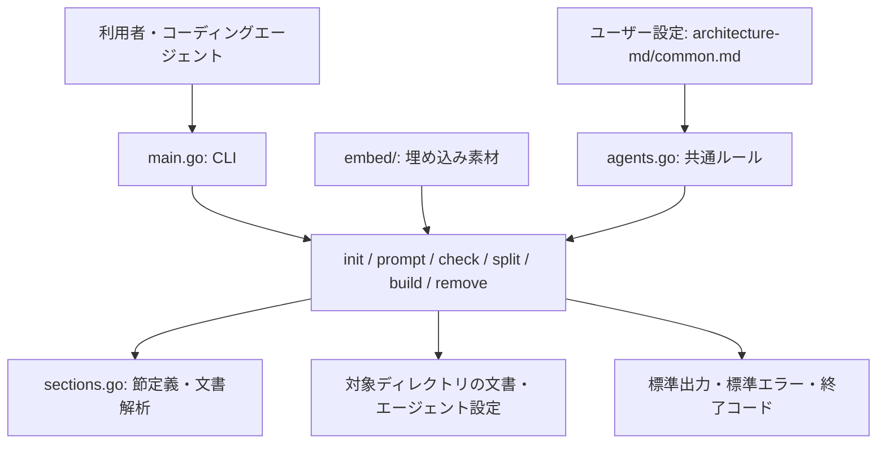

<!-- Section layout inspired by https://architecture.md/ -->
# Architecture Overview

<!-- arch:project-structure -->
## Project layout

- ルート直下: 単一の Go `main` パッケージ。CLI、文書の初期配置・検証・分割・結合・撤去、更新依頼文の生成を実装する。
- `embed/`: `go:embed` でバイナリに含める文書テンプレート、エージェント向け運用ルール、出典表記。
- `*_test.go` と `testdata/`: コマンド・文書解析・ファイル操作のテストと、期待出力（golden）・入力文書。
- `README.md`: コマンドの利用方法、設定、検証方法、仕様上の前提。
- `AGENTS.md`: このリポジトリの文書更新ルール。`ARCHITECTURE.md.template` は全節の見本、`ARCHITECTURE.md` は現在の構成を記録する。

<!-- arch:high-level-diagram -->
## System map

実行時の処理はローカルファイルで完結する。`prompt` は更新依頼文を出力し、エージェントや LLM の呼び出しは利用者が外部で行う。

<!-- arch:core-components -->
## Components

- `main.go`: 引数・対象ディレクトリ・行数制限を解析し、各コマンドへ振り分ける。ヘルプ、バージョン表示、終了コードもここで扱う。
- `sections.go`: 既知の12節と必須4節を定義する。改行を正規化し、コードフェンスを除外して ID マーカーと H2 を解析する。節の追加・解析仕様の変更は検証・分割・骨組み生成に影響する。
- `template.go` と `embed/`: 配布素材を埋め込み、必須節だけの骨組みを生成する。配布する文書・ルールの変更箇所。
- `init.go`: 対象にテンプレートと骨組みを新規配置する。既存文書は保持し、既存のエージェント設定がある場合は追記用ブロックを出力する。
- `agents.go`: `AGENTS.md` / `CLAUDE.md` の検出、運用ブロックの生成・除去、`os.UserConfigDir()/architecture-md/common.md` の共通ルール読み込み。`check` の参照確認は `AGENTS.md` を優先する。
- `check.go`: 必須節、ID の重複、見出し、行数、エージェント設定からの参照を検証する。`.architecture/` がある場合は生成結果とのバイト単位の一致も確認する。
- `split.go` / `build.go`: 文書を `.architecture/` のヘッダー・節ファイルへ分割し、直下の Markdown をファイル名順に結合して `ARCHITECTURE.md` を生成する。このリポジトリ自体は分割管理を使用していない。
- `prompt.go`: 共通ルール、直接編集か分割編集かの指示、`check` の診断を更新依頼文にまとめる。ファイル変更や外部コマンド実行は行わない。
- `remove.go`: 撤去対象を事前確認し、既定では予定だけを表示する。`--yes` で文書・分割ファイル・運用ブロックを撤去する。テンプレートと共通設定は保持する。
- `main_test.go`、`sections_test.go`、`prompt_test.go`、`remove_test.go`、`guidance_test.go`: CLI の振る舞い、解析、生成結果、既存内容の保持、エラー時の動作を検証する。検証コマンドは `README.md` を参照する。

<!-- arch:project-identification -->
## About this project

- プロジェクト名: `archmd`（Go モジュール名も `archmd`）。アーキテクチャ文書とエージェント向け運用ルールの配置・維持・検証を補助する CLI。
- 実装基盤: Go 1.22 以上、標準ライブラリのみ。実行時のネットワーク接続や外部サービスへの依存はない。
- リポジトリの公開 URL・保守担当者: Not confirmed from the repository.
- 最終確認日: 2026-11-12。
