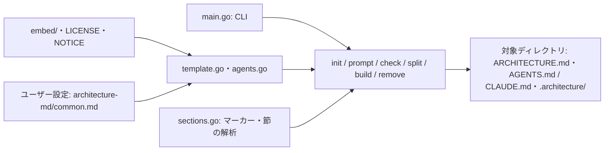

<!-- Section layout inspired by https://architecture.md/ -->
<!--
出典: ARCHITECTURE.md Template by timajwilliams (https://github.com/timajwilliams/architecture)。
archmd により節・見出し・説明を再構成し、ID マーカーと更新ルールを追加。
SPDX-License-Identifier: Apache-2.0
ライセンス全文: https://www.apache.org/licenses/LICENSE-2.0.txt
再配布時はこの表示を保持し、Apache-2.0 全文と archmd notices の出典表示を同梱する。
この表示はテンプレート・ルールに適用され、記載対象プロジェクトのライセンスは指定しない。
-->
# Architecture Overview

<!-- arch:project-structure | Project layout | Map the main directories to their responsibilities. -->
## プロジェクト構成

- ルート直下: 単一の `package main` に CLI と文書操作を実装。`*_test.go` は各機能とコマンドのテスト。
- `embed/`: バイナリに埋め込む文書テンプレートとエージェント向け運用ルール。
- `testdata/`: Markdown の入力例と出力比較用の golden ファイル。
- `README.md`: 利用・検証・リリース手順。`LICENSE` と `NOTICE` はライセンスと出典表示。

<!-- arch:high-level-diagram | System map | Show the system overview and connections between major components. -->
## システム構成

<!-- arch:core-components | Components | Describe each central module and the responsibility it owns. -->
## 主要コンポーネント

- `main.go`: コマンド・引数・終了コードを制御し、Go ビルド情報から版を取得する。
- `sections.go`: 全12節の ID・見出し・ヒントと必須4節を定義し、コードフェンスを考慮してマーカーと H2 を解析する。文書形式の変更は生成・検証・分割に影響する。
- `template.go`・`agents.go`: 埋め込み資源からテンプレート・骨組み・運用ブロックを生成する。共通ルールの読み込み、エージェント設定の選択、改行を保持する処理も担う。
- `init.go`・`prompt.go`: 文書と運用ルールの初期配置、およびルール・検証診断を含む更新依頼文の出力。`prompt` 自体はファイルを変更せず、外部コマンドも呼ばない。
- `check.go`: 必須 ID・重複・見出し・行数・運用ルールへの参照・版を診断し、分割構成では生成物とのバイト単位の一致も検証する。
- `split.go`・`build.go`: 文書を対象側の `.architecture/` に節別に分割し、ファイル名順に結合する。`00-header.md` を持つ分割形式では元の改行・空行・末尾改行を保持する。
- `remove.go`: 文書・旧テンプレート・分割ファイル・運用ブロックの撤去を計画する。既定は dry-run、`--yes` で適用し、`--keep-architecture-md` で本文を残せる。

<!-- arch:data-stores | Data stores | Name persistent stores and their tables or collections without detailed schemas. -->
<!-- arch:external-integrations | External services | Identify outside services and the reason each connection exists. -->
<!-- arch:deployment-infrastructure | Build and deploy | Outline where the system runs and how changes reach it. -->
## ビルドと配布

- Go 1.24 以上と標準ライブラリのみで動作するローカル CLI。`go build -o archmd .` でビルドし、実行時に LLM やネットワークへアクセスしない。
- リリースは `vX.Y.Z` タグの作成・push で管理する。版表示・刻印は Go ビルド情報に基づき、開発ビルドは `dev` となる。
- `release.sh` は最新タグのパッチ版を1つ上げ、検証、AGENTS.md のブロック再生成、必要なコミット、タグ作成、確認後の `origin` への push を行う。`--no-push` はローカルのコミットとタグ作成まで行う。
- `LICENSE`・`NOTICE` はバイナリにも埋め込み、`archmd notices` で取得できる。再配布時の同梱要件は [README.md](README.md) を参照。

<!-- arch:decisions | Key decisions | Summarize each decision and its reason in one line. -->
<!-- arch:security-considerations | Security | Summarize access boundaries and protections for sensitive information. -->
## ファイル操作の保護

- `remove.go` は対象直下のシンボリックリンクや想定外のファイル種別を拒否し、`agents.go` は不正・入れ子の運用ブロックを拒否する。撤去計画は変更前に全対象を検証するが、適用中の OS エラーに対するロールバックは行わない。
- `split.go` は重複 ID とファイル名に使えない文字を含む ID を書き込み前に拒否する。

<!-- arch:dev-testing-environment | Development and testing | Name essential development tools and checks and link to setup instructions. -->
## 開発と検証

- `go test ./...` で機能・CLI・golden 出力を検証し、`go vet ./...` と `gofmt -l .` で静的検査・書式確認を行う。
- 文書更新後は `archmd check` を実行する。利用・設定・検証手順は [README.md](README.md) を参照。

<!-- arch:future-considerations | Roadmap and known debt | Record likely architectural changes and unresolved design constraints. -->
<!-- arch:project-identification | About this project | Identify this project, its repository and maintainers, and its last reviewed date (YYYY-MM-DD). -->
## プロジェクト情報

archmd は、ARCHITECTURE.md とエージェント向け運用ルールの配置・更新依頼・検証を補助する CLI。リポジトリは `go.mod` に記載の `github.com/wasuken/archmd`。最終確認日: 2026-11-14。

<!-- arch:glossary | Glossary | Define local terminology that a new contributor needs to understand. -->
