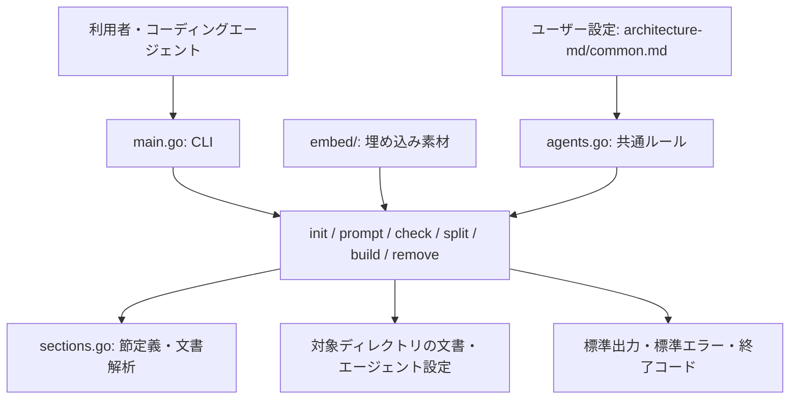

<!-- Section layout inspired by https://architecture.md/ -->
<!--
出典: ARCHITECTURE.md Template by timajwilliams (https://github.com/timajwilliams/architecture)。
archmd により節・見出し・説明を再構成し、ID マーカーと更新ルールを追加。
SPDX-License-Identifier: Apache-2.0
ライセンス全文: https://www.apache.org/licenses/LICENSE-2.0.txt
再配布時はこの表示を保持し、Apache-2.0 全文と archmd notices の出典表示を同梱する。
この表示はテンプレート・ルールに適用され、記載対象プロジェクトのライセンスは指定しない。
-->
# Architecture Overview

<!-- arch:project-structure | Project layout | Map the main directories to their responsibilities. -->
## Project layout

- ルート直下: 単一の Go `main` パッケージ。CLI、文書の初期配置・検証・分割・結合・撤去、更新依頼文の生成を実装する。
- `embed/`: `go:embed` でバイナリに含める文書テンプレートとエージェント向け運用ルール。ルートの `LICENSE`・`NOTICE` もバイナリへ埋め込み、`notices` で全文を出力する。
- `*_test.go` と `testdata/`: コマンド・文書解析・ファイル操作のテストと、期待出力（golden）・入力文書。
- `README.md`: コマンドの利用方法、設定、検証方法、仕様上の前提。
- `AGENTS.md`: このリポジトリの文書更新ルール。`ARCHITECTURE.md` は全12節のマーカーと現在の構成を記録する。

<!-- arch:high-level-diagram | System map | Show the system overview and connections between major components. -->
## System map

実行時の処理はローカルファイルで完結する。`prompt` は更新依頼文を出力し、エージェントや LLM の呼び出しは利用者が外部で行う。

<!-- arch:core-components | Components | Describe each central module and the responsibility it owns. -->
## Components

- `main.go`: 引数・対象ディレクトリ・行数制限を解析し、各コマンドへ振り分ける。ヘルプ、バージョン表示、終了コードもここで扱う。
- `sections.go`: 既知の12節と必須4節を定義する。改行を正規化し、コードフェンスを除外して ID マーカーと H2 を解析する。節の追加・解析仕様の変更は検証・分割・骨組み生成に影響する。
- `template.go` と `embed/`: 配布素材を埋め込み、テンプレートのプレースホルダーを `main.go` の版定数で置換する。マーカーには見出しとヒントを含め、骨組みには出典・変更・ライセンス表示、全12節のマーカーと必須4節の見出しを含める。配布する文書・ルールの変更箇所。
- `init.go`: 対象に骨組みを新規配置する。旧テンプレートファイルは作成・変更しない。既存のエージェント設定がある場合は追記用ブロックを出力する。`--write-agents` 指定時は AGENTS.md（無ければ CLAUDE.md）のマーカーを検証し、既存バイト列を保持して追記する。
- `agents.go`: `AGENTS.md` / `CLAUDE.md` の検出、運用ブロックの生成・除去、`os.UserConfigDir()/architecture-md/common.md` の共通ルール読み込み。`check` の参照確認は `AGENTS.md` を優先する。
- `check.go`: 必須節、ID の重複、見出し、マーカーを除く行数、エージェント設定からの参照を検証する。任意節のマーカー欠落、旧マーカー形式、旧テンプレートの残存は WARN で通知する。テンプレートと優先するエージェント設定のブロックが古い版なら INFO で通知する。`.architecture/` がある場合は生成結果とのバイト単位の一致も確認する。
- `split.go` / `build.go`: 文書を `.architecture/` のヘッダー・節ファイルへ分割し、直下の Markdown をファイル名順に結合して `ARCHITECTURE.md` を生成する。`00-header.md` がある分割形式では改行・空行・末尾改行を含めた元のバイト列を保持し、手動構成では生成ヘッダーと区切りを付ける。このリポジトリ自体は分割管理を使用していない。
- `prompt.go`: 共通ルール、直接編集か分割編集かの指示、`check` の診断を更新依頼文にまとめる。旧形式・旧テンプレートの撤去案内は依頼文から除外する。ファイル変更や外部コマンド実行は行わない。
- `remove.go`: 撤去対象を事前確認し、既定では予定だけを表示する。`--yes` で文書・旧 `ARCHITECTURE.md.template`・分割ファイル・運用ブロックを撤去し、ブロック除去後に空白だけになったエージェント設定ファイルも削除する。`--keep-architecture-md` は文書を保持して生成ヘッダーを除去するが、旧テンプレートは削除する。共通設定は保持し、対象直下のシンボリックリンクや不正なブロックは変更前に拒否する。
- `*_test.go`: CLI の振る舞い、解析、生成結果、既存内容の保持、エラー時の動作を検証する。`check_test.go` と `template_test.go` は版の数値比較・通知と刻印も検証する。検証コマンドは `README.md` を参照する。

<!-- arch:data-stores | Data stores | Name persistent stores and their tables or collections without detailed schemas. -->
<!-- arch:external-integrations | External services | Identify outside services and the reason each connection exists. -->
<!-- arch:deployment-infrastructure | Build and deploy | Outline where the system runs and how changes reach it. -->
<!-- arch:decisions | Key decisions | Summarize each decision and its reason in one line. -->
<!-- arch:security-considerations | Security | Summarize access boundaries and protections for sensitive information. -->
<!-- arch:dev-testing-environment | Development and testing | Name essential development tools and checks and link to setup instructions. -->
<!-- arch:future-considerations | Roadmap and known debt | Record likely architectural changes and unresolved design constraints. -->
<!-- arch:project-identification | About this project | Identify this project, its repository and maintainers, and its last reviewed date (YYYY-MM-DD). -->
## About this project

- プロジェクト名: `archmd`（Go モジュール名: `github.com/wasuken/archmd`）。アーキテクチャ文書とエージェント向け運用ルールの配置・維持・検証を補助する CLI。
- 実装基盤: Go 1.22 以上、標準ライブラリのみ。実行時のネットワーク接続や外部サービスへの依存はない。
- リポジトリ: `go.mod` のモジュールパスは `github.com/wasuken/archmd`。公開状況・保守担当者: Not confirmed from the repository.
- ライセンス: Apache-2.0。`LICENSE` が全文、`NOTICE` が元テンプレートの出典・参照コミット・変更表示。
- 最終確認日: 2026-11-14。

<!-- arch:glossary | Glossary | Define local terminology that a new contributor needs to understand. -->
